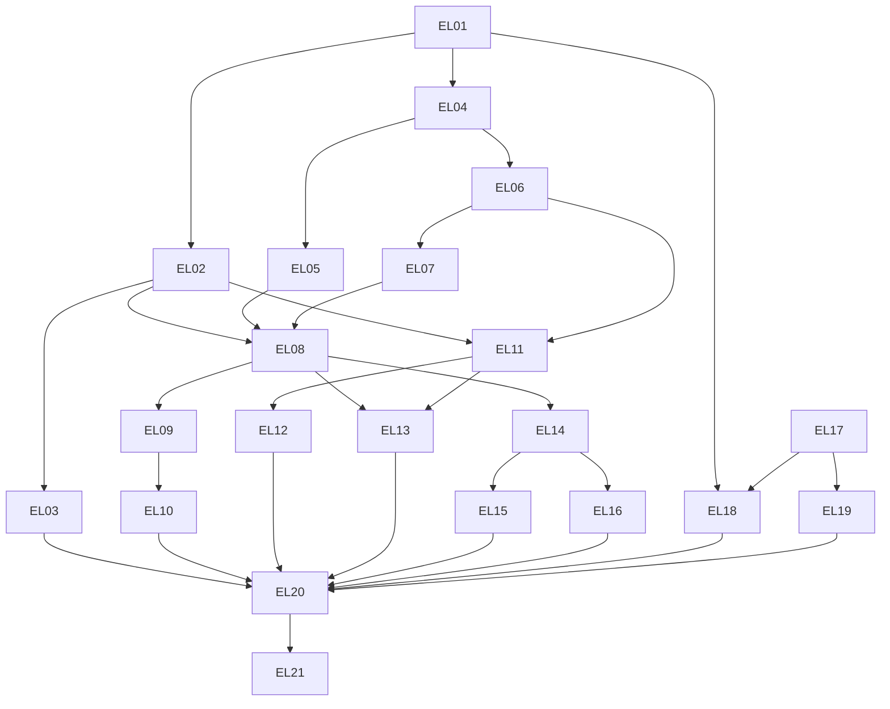

# 已确认 tickets：可验证学习效果与个性化训练

> 归档说明（2026-11-03）：本文保留规格／任务发布时的快照。文中的“未实施”等状态只描述当时；当前进度以 GitHub Issues、已合并 PR 和 dev 分支为准，参见 [资料索引](../../README.md)。

- 日期：2026-10-31。
- 状态：**已确认并发布 21 张 GitHub Issues，直接标记 ready-for-agent；产品未实施。**
- 来源：[六项总规格](../../specs/evidence-based-personalized-learning.md)。本目录记录已确认任务与发布映射；产品未实施，已有 tracker 父 issue 保持不变。
- 共 21 张已确认 ticket、31 条直接阻塞边。每票包含用户行为、验收条件、相关层、Blocked by、验证命令、明确不做、独立验收和功能回退。
- 已按已配置 GitHub Issues 发布，一票一个 issue，直接使用 `ready-for-agent`，未重复 triage。实际编号见下表及 [发布记录](publication.md)。
- 六项全在范围内：F1 掌握/毕业；F2 课程；F3 故事；F4 回测/建议；F5 时间预算；F6 场景。整份交付须包含全部六项。

## 已确认清单

| Ticket | GitHub | 阶段 | 用户行为切片 | Blocked by |
| --- | --- | --- | --- | --- |
| [EL-01](01-expand-revisions-and-v3.md) | [#37](https://github.com/Zeming-Yuan/english-coach/issues/37) | expand：内容修订与备份兼容 | Expand：编辑词卡后仍能完整备份与恢复内容修订 | None |
| [EL-02](02-recall-evidence-detail.md) | [#38](https://github.com/Zeming-Yuan/english-coach/issues/38) | migrate：词卡详情证据链 | 独立作答后，在词卡详情看到有依据的回忆状态 | EL-01 |
| [EL-03](03-migrate-evidence-readers.md) | [#39](https://github.com/Zeming-Yuan/english-coach/issues/39) | migrate：证据读取入口 | Migrate：首页、词表、统计和分享图统一解释学习进展 | EL-02 |
| [EL-04](04-expand-contact-recording.md) | [#40](https://github.com/Zeming-Yuan/english-coach/issues/40) | expand：接触记录与确认 | Expand：看词卡或听答案后，能核对最近一次应用内接触 | EL-01 |
| [EL-05](05-migrate-practice-contact.md) | [#41](https://github.com/Zeming-Yuan/english-coach/issues/41) | migrate：既有练习入口 | Migrate：闪卡与专项练习准确记录答案接触和提示 | EL-04 |
| [EL-06](06-migrate-content-contact.md) | [#42](https://github.com/Zeming-Yuan/english-coach/issues/42) | migrate：课程/故事内容入口 | Migrate：课程、故事和内容编辑保持可追溯的接触与修订 | EL-04 |
| [EL-07](07-lesson-goals-and-progress.md) | [#43](https://github.com/Zeming-Yuan/english-coach/issues/43) | 垂直切片：课程学习状态 | 课程有明确目标，生成、浏览和待检查分别记录 | EL-06 |
| [EL-08](08-lesson-recall-check.md) | [#44](https://github.com/Zeming-Yuan/english-coach/issues/44) | 垂直切片：首个持久练习上下文 | 课程三题短测可保存、继续，并留下可解释的结果 | EL-02、EL-05、EL-07 |
| [EL-09](09-delayed-recall-check.md) | [#45](https://github.com/Zeming-Yuan/english-coach/issues/45) | 垂直切片：延迟保持 | 隔日和一周回测按真实记录间隔计分 | EL-08 |
| [EL-10](10-actionable-learning-advice.md) | [#46](https://github.com/Zeming-Yuan/english-coach/issues/46) | 垂直切片：统计到行动 | 统计能解释薄弱项，并一键进入对应练习 | EL-09 |
| [EL-11](11-bounded-personalized-story.md) | [#47](https://github.com/Zeming-Yuan/english-coach/issues/47) | 垂直切片：可理解故事 | 根据已有学习依据生成难度受控的短故事 | EL-02、EL-06 |
| [EL-12](12-simpler-story-version.md) | [#48](https://github.com/Zeming-Yuan/english-coach/issues/48) | 垂直切片：简化故事 | 把故事变简单，同时保留原版与各自结果 | EL-11 |
| [EL-13](13-story-reading-check.md) | [#49](https://github.com/Zeming-Yuan/english-coach/issues/49) | 垂直切片：阅读到检查 | 读后两题检查区分理解、独立回忆和回看帮助 | EL-08、EL-11 |
| [EL-14](14-three-turn-drink-scene.md) | [#50](https://github.com/Zeming-Yuan/english-coach/issues/50) | 垂直切片：模板场景与应用证据 | 用三轮买饮品任务建立首个可恢复的场景练习 | EL-08 |
| [EL-15](15-intro-and-directions-scenes.md) | [#51](https://github.com/Zeming-Yuan/english-coach/issues/51) | 垂直切片：三类场景覆盖 | 扩展自我介绍和问路，保留各场景的任务边界 | EL-14 |
| [EL-16](16-bounded-ai-scene-feedback.md) | [#52](https://github.com/Zeming-Yuan/english-coach/issues/52) | 垂直切片：受控 AI 增强 | AI 提供受约束的场景回应，失败仍能继续 | EL-14 |
| [EL-17](17-time-budget-daily-plan.md) | [#53](https://github.com/Zeming-Yuan/english-coach/issues/53) | 垂直切片：时间预算主线 | 按 3/8/15 分钟开始、暂停和继续每日词卡计划 | None |
| [EL-18](18-personal-active-time-estimate.md) | [#54](https://github.com/Zeming-Yuan/english-coach/issues/54) | 垂直切片：个人负担校准 | 实际主动用时逐步改善计划估算 | EL-01、EL-17 |
| [EL-19](19-return-to-learning-mode.md) | [#55](https://github.com/Zeming-Yuan/english-coach/issues/55) | 垂直切片：恢复模式 | 中断后用有限复习恢复学习 | EL-17 |
| [EL-20](20-contract-evidence-consumers.md) | [#56](https://github.com/Zeming-Yuan/english-coach/issues/56) | contract：兼容能力保留，移除旧内部判定 | Contract：收口证据、接触与新备份的全部内部消费者 | EL-03、EL-10、EL-12、EL-13、EL-15、EL-16、EL-18、EL-19 |
| [EL-21](21-integrated-learning-restore-qualification.md) | [#57](https://github.com/Zeming-Yuan/english-coach/issues/57) | 集成交付切片：端到端资格 | 完整演练六项学习、换设备恢复与继续学习 | EL-20 |

## 阻塞图



## 为什么这样划分

1. EL-01 是首个加法扩展，通过“编辑一个词→V3 下载→另一实例恢复”演示内容身份和数据保护；不把 schema、API、UI 分成三张横向票。EL-04 通过真实看词/播放→接触确认→详情依据建立第二个最小扩展。
2. EL-02/03 迁移能力判断与读取，EL-05/06 按入口迁移接触和修订，随后功能票消费同一套已扩展契约。EL-20 等全部消费者迁移后收口内部旧分支，保留旧公开字段/URL/记录/备份兼容；这是 expand → 迁移 → contract，不是一次大替换。
3. EL-07 先交付目标/浏览状态和原子生成，EL-08 以“本课三题小测”引入持久练习上下文，避免只做一个不可演示的通用框架。EL-09/13/14 分别在回测、读后和场景中复用它。
4. EL-09 等 EL-08 已经间接获得 EL-05/06 的完整既有接触路径；无需再列重复的间接阻塞边。EL-10 再连接可执行建议和课程回测归属。
5. EL-11/12/13 分别交付“生成适合材料”“更简单版本”“读后检查”。EL-13 不等待 EL-12：只要版本契约成立，可先检查标准故事，简化结果随后按相同契约使用。
6. EL-14 用完整的三轮买饮品模板验证场景判定、持久化和应用证据。EL-15 扩展其他两类，EL-16 增强 AI 回应，两者都只依赖 EL-14，可以独立推进。AI 不成为规则与评分权威。
7. EL-17 直接使用现有队列、事件和浏览器轮次，当前就能开始，不被能力/故事开发人为阻塞。EL-18 引入可恢复的主动时长，需要 EL-01 的 V3；EL-19 用现有学习日做恢复模式，不需要等个人估算。
8. EL-20 的八个直接前置恰是功能迁移完成后的 frontier；它们已经间接覆盖其余前置。EL-21 只依赖 EL-20，集中验收“六项学习→换设备→继续”，不替前置票补各自必需功能或测试。
9. 每票原则上适合一个新上下文：一条完整用户行为、有限表面、自己的正常/失败/回退演示。EL-01、EL-08 与 EL-14 边界相对更重，但已压到首个可独立使用的端到端闭环；若需更细，应按独立用户行为再拆，不能拆成纯加表或纯页面票。
10. 共享服务、数据库迁移和同一页面修改按项目规则串行集成；编辑冲突不额外制造业务阻塞。前置未合入的共享状态不能被多个实现者同时修改。

## 当前可以开始的 frontier

- **EL-01**：内容修订与 V3 数据保全。
- **EL-17**：默认估算的时间预算主线。

其余等待各自直接前置。粒度和阻塞关系已获确认；有阻塞票仍须等待各自前置完成。

## 每票共同完成标准

- 能在本票加已完成前置的状态下演示正常结果、异常恢复和功能回退，不能依赖未来票补齐。
- 沿用已确认的唯一最高 seam：浏览器→真实前端/后端/FSRS/事务→真实迁移隔离 SQLite。外部 AI/TTS 可替换，时间可控；成功应用 API 不造假。
- 新数据在引入当票就进入 V3 的导出/校验/映射/恢复；EL-21 检查组合完整性，不充当此前允许丢新数据的理由。
- 每票维护自己的具名 E2E 及覆盖登记，未过滤入口运行全部已交付场景。未实现票的场景不提前进入必跑清单；本地 EL 编号也不能冒充现有过滤命令支持的 EC-NN。
- 旧公开能力保留；能力不确定时保守说明，不能在回退时恢复“次数等于掌握”或补造缺失历史。
- 新增 schema 采用向前兼容方式；功能回退保留数据与必要适配，有后继时逆依赖处理。回退验证不以清空新数据为成功。

## 验证命令

当前工作区没有系统 `python` 别名，项目虚拟环境存在。逐票采用可直接定位解释器的命令：

```bash
.venv/bin/python -m pytest -q
npm --prefix frontend run test:e2e
```

从仓库根目录运行。E2E 包含重新构建、双视口和真实应用夹具。每张票文件自带这些命令及独立演示步骤；这是实施后的要求，本次文档交付只核验文档，不宣称产品测试通过。

## 规格澄清

- 回测推荐必须避免先展示英文答案。具体目标可以用中文释义、课名或数量表达；若用户展开英文，按已确认的接触规则重算资格。这是对既有“具体词入口”与“真实间隔”两条规则的一致解释，不放松任何一条。
- 不为让首个场景起步而要求故事功能全部完成：场景首先使用自己的核对模板和版本化规则。相同类型的内容注册能力可复用，故事流水线不是场景的业务前置。
- 验收条件映射表示责任归属，不能只凭表格中出现编号认定功能通过。逐票的勾选条件和演示步骤才是可执行判据。
- 已有 tracker 总规格/父 issue 不在本次发布中修改或关闭；来源目前是本地规格，不虚构 parent issue。

## 验收条件覆盖

| 规格条件 | 主要实现/收口责任（不含集成票） | 集成验收 |
| --- | --- | --- |
| AC01 | EL-02、EL-03、EL-20 | EL-21 |
| AC02 | EL-03、EL-20 | EL-21 |
| AC03 | EL-02、EL-03、EL-05、EL-20 | EL-21 |
| AC04 | EL-02 | EL-21 |
| AC05 | EL-02、EL-03、EL-20 | EL-21 |
| AC06 | EL-02、EL-03、EL-09 | EL-21 |
| AC07 | EL-01、EL-02、EL-06、EL-20 | EL-21 |
| AC08 | EL-07、EL-10 | EL-21 |
| AC09 | EL-07 | EL-21 |
| AC10 | EL-08 | EL-21 |
| AC11 | EL-07、EL-08 | EL-21 |
| AC12 | EL-08 | EL-21 |
| AC13 | EL-07 | EL-21 |
| AC14 | EL-11 | EL-21 |
| AC15 | EL-11 | EL-21 |
| AC16 | EL-12 | EL-21 |
| AC17 | EL-13 | EL-21 |
| AC18 | EL-11、EL-12、EL-13 | EL-21 |
| AC19 | EL-11、EL-12、EL-13 | EL-21 |
| AC20 | EL-09 | EL-21 |
| AC21 | EL-04、EL-05、EL-06、EL-09 | EL-21 |
| AC22 | EL-09 | EL-21 |
| AC23 | EL-04、EL-06、EL-09 | EL-21 |
| AC24 | EL-10 | EL-21 |
| AC25 | EL-10 | EL-21 |
| AC26 | EL-17 | EL-21 |
| AC27 | EL-17 | EL-21 |
| AC28 | EL-18 | EL-21 |
| AC29 | EL-17 | EL-21 |
| AC30 | EL-19 | EL-21 |
| AC31 | EL-14、EL-15、EL-16 | EL-21 |
| AC32 | EL-14、EL-15、EL-16 | EL-21 |
| AC33 | EL-14、EL-15、EL-16 | EL-21 |
| AC34 | EL-14、EL-15、EL-16 | EL-21 |
| AC35 | EL-04、EL-05、EL-07、EL-08、EL-09、EL-10、EL-11、EL-13、EL-14、EL-16、EL-17、EL-18、EL-19、EL-20 | EL-21 |
| AC36 | EL-04、EL-05、EL-06、EL-07、EL-08、EL-09、EL-10、EL-11、EL-12、EL-13、EL-14、EL-15、EL-16、EL-17、EL-19、EL-20 | EL-21 |
| AC37 | EL-04、EL-05、EL-06、EL-07、EL-08、EL-09、EL-11、EL-13、EL-14、EL-16、EL-17、EL-18、EL-19、EL-20 | EL-21 |
| AC38 | EL-01、EL-20 | EL-21 |
| AC39 | EL-01、EL-04、EL-08、EL-12、EL-13、EL-14、EL-15、EL-18、EL-20 | EL-21 |
| AC40 | EL-01、EL-20 | EL-21 |
| AC41 | EL-01、EL-20 | EL-21 |
| AC42 | EL-01、EL-20 | EL-21 |
| AC43 | EL-21（整体验收专属） | EL-21 |

## 发布约定

用户已确认粒度、31 条直接阻塞关系并授权上传 GitHub。已按依赖顺序一票一个 issue，直接标记 `ready-for-agent`。

EL 身份已映射到真实 issue，原生阻塞关系与正文 Blocked by 均保留；回读核对标题、完整正文、标签和 31 条边。发布全过程未重复 triage，未关闭或修改已有父 issue。详见 [发布记录](publication.md)。
