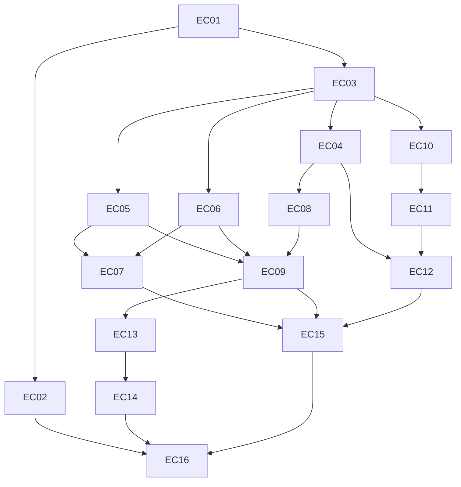

# 已确认 tickets：可靠性与每日学习闭环

> 归档说明（2026-11-03）：本文保留规格／任务发布时的快照。文中的“未实施”等状态只描述当时；当前进度以 GitHub Issues、已合并 PR 和 dev 分支为准，参见 [资料索引](../../README.md)。

- 日期：2026-10-30。
- 状态：用户已确认16张ticket的粒度与阻塞关系；实施计划已随对应GitHub issue发布，原生父子关联与23条阻塞边已回读核验。
- 来源：[完整规格](../../specs/reliability-and-daily-learning.md)。不改写已确认的最高测试 seam，也不新增一轮产品访谈。
- 每张票包含用户行为、验收条件、涉及层、Blocked by、验证命令、明确不做、独立验收和回退方式，可供单独的新上下文使用。
- 不重复 triage。已确认后直接作为 ready-for-agent tickets；有未完成阻塞的票仍须等待其 frontier，标签不是跳过阻塞的授权。
- 用户已授权统一上传；[GitHub规格与执行总览](https://github.com/Zeming-Yuan/english-coach/issues/1)；[逐票发布映射与核验记录](publication.md)。

## 已确认清单

| Ticket | 阶段 | 用户行为切片 | Blocked by |
| --- | --- | --- | --- |
| [EC-01](01-first-install.md) | 基础切片 | 全新安装和旧库升级后能打开真实首页 | None |
| [EC-02](02-starter-cards.md) | 垂直切片 | 没有 AI 密钥也能体验首轮学习 | EC-01 |
| [EC-03](03-expand-event-history.md) | expand | Expand：新增学习事件，首次看见真实评分轨迹 | EC-01 |
| [EC-04](04-self-rating-retry.md) | migrate：自评分入口 | 迁移自评分：保存确认、幂等重试与刷新恢复 | EC-03 |
| [EC-05](05-typed-retrieval.md) | migrate：客观输入入口 | 迁移拼写与填空：一次提交，区分独立回忆和提示 | EC-03 |
| [EC-06](06-recognition-practice.md) | migrate：选择入口 | 迁移测验选择与听力：服务端判分，识别练习不改排期 | EC-03 |
| [EC-07](07-mixed-practice.md) | migrate：混合入口 | 迁移混合练习：同题同规则，一次操作只记录一次 | EC-05、EC-06 |
| [EC-08](08-history-calendar.md) | migrate：历史读取 | 跨天历史、热力图和连续学习天数可信 | EC-04 |
| [EC-09](09-metrics-adaptive-limit.md) | migrate：指标与推荐 | 区分正确率与自评通过率，可靠调节新词量 | EC-05、EC-06、EC-08 |
| [EC-10](10-complete-backup-export.md) | 垂直切片：备份导出 | 从界面导出完整、带版本的数据库备份 | EC-03 |
| [EC-11](11-safe-legacy-import.md) | 垂直切片：兼容恢复 | 旧备份导入不串卡，失败不清空原进度 | EC-10 |
| [EC-12](12-full-backup-restore.md) | 垂直切片：全量恢复 | 完整备份恢复到另一实例后继续学习 | EC-04、EC-11 |
| [EC-13](13-daily-queue.md) | 垂直切片：每日主队列 | 首页一键开始到期优先、目标固定的每日学习 | EC-09 |
| [EC-14](14-reinforcement-summary.md) | 垂直切片：巩固与完成 | 结束主队列后做有限巩固并获得可信反馈 | EC-13 |
| [EC-15](15-contract-legacy-paths.md) | contract | Contract：收口到唯一学习记录规则，移除旧业务分支 | EC-07、EC-09、EC-12 |
| [EC-16](16-release-journey.md) | 集成交付切片 | 在新机器到换设备的完整旅程中独立验收 | EC-02、EC-14、EC-15 |

## 阻塞图

## 粒度与依赖的理由

- EC-01 先交付真实启动与验收基础，避免后续切片只能在按模型建表的假前提下验证。
- 记录改造是唯一的宽改造序列：EC-03 expand → EC-04/05/06/07 的写入迁移，以及 EC-08/09 的读取迁移 → EC-15 contract。保留兼容面，逐批合入保持绿色。
- EC-03 的扩展带有最小的用户可见结果：新评分轨迹；不是只有加表或抽工具的水平任务。迁移中未分类入口不冒充已经完整覆盖的历史。
- EC-04、EC-05、EC-06 在扩展契约后可独立推进，EC-07 只等待两类客观题契约。它们修改共享视图或服务时须串行合入；编辑冲突不伪装成业务阻塞边。
- EC-08 从真实自评提交验证跨天历史；EC-09 还需要输入与选择分类结果，所以只等 EC-05、EC-06、EC-08，不等混合页面。
- 备份可以在事件结构稳定后开始；先 EC-10 完整只读导出，再 EC-11 修好已有旧导入，再 EC-12 接全量恢复。不会在等待新格式期间撤掉可用的旧导入或留下先删后校验的实现。
- EC-12 等 EC-04，是为了能独立演示恢复后的旧提交重试仍幂等；不等全部练习页面改完。
- 每日队列只依赖可靠推荐和统计（EC-09）；巩固接在 EC-13 后复用输入题切片，EC-05 已被其前置依赖间接满足，不重复添加阻塞边，也不强行等待备份或混合练习。
- EC-15 等所有会读写旧记录形态的迁移批次，但不阻塞在入门文案或每日 UI 收尾；保留公共 API 与兼容数据，不做破坏性物理删除。
- EC-16 是“新安装到换设备继续学”的集成交付切片，汇总全部 frontier。每张前置票在此之前已经能够独立演示、验证和回退。

## 验证入口约定

- 基本环境：已安装 Python 与前端依赖，激活项目虚拟环境，从仓库根目录运行；测试不需要真实密钥。
- EC-01 交付 npm 的 test:e2e 入口与 --ticket EC-XX 过滤；每个后续 ticket 增加自己的必跑场景。未知票号或无用例匹配是失败，不允许假绿。
- 不带过滤运行全部已交付场景。EC-16 负责把父规格 T01–T21 全部接入最终验收，但不负责替其他票补实现或补其必需测试。
- 主命令完成本次前端构建，使用隔离数据、真实应用与迁移，管理测试进程，失败非零退出并留诊断。
- 逐票命令是未来交付契约；目前尚未实现 test:e2e，未声称这些命令已经通过。

## 回退共同约定

- 每票记录功能回退和数据保护；加法式数据结构保留，新事件不因撤回 UI 丢失。
- 有后续消费者时按依赖逆序回退，或保留 API/数据兼容契约并关闭入口，不直接撤掉被依赖能力。
- 新备份、预升级副本和事务回滚保护不同故障；已产生新进度后不能直接恢复旧快照，把数据丢失当作版本回退。
- EC-15 删除的是已无消费者的内部业务分支；本轮 contract 不物理删除兼容历史字段或公共端点，保持可演练的回退面。

## 发布记录

16张票及其完整计划已发布到GitHub Issues，直接标记ready-for-agent，无需重复triage。EC编号、真实issue链接、原生父子关联与阻塞关系见[发布映射](publication.md)。当前只有EC-01无阻塞可开始；实施和代码发行另按用户指令推进。

## 实施计划

[16份计划、共享接口和覆盖索引](../../superpowers/plans/2026-10-30-reliability-index.md)。各ticket也已链接对应计划。基础幂等/pending契约归EC-03，EC-04负责完整页面恢复闭环，避免05/06产生隐含依赖。
