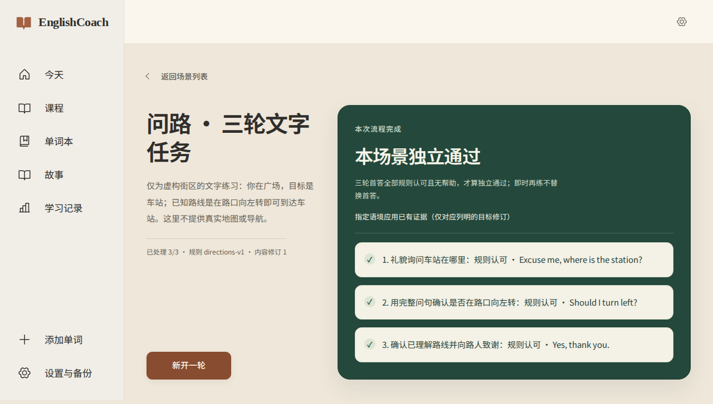
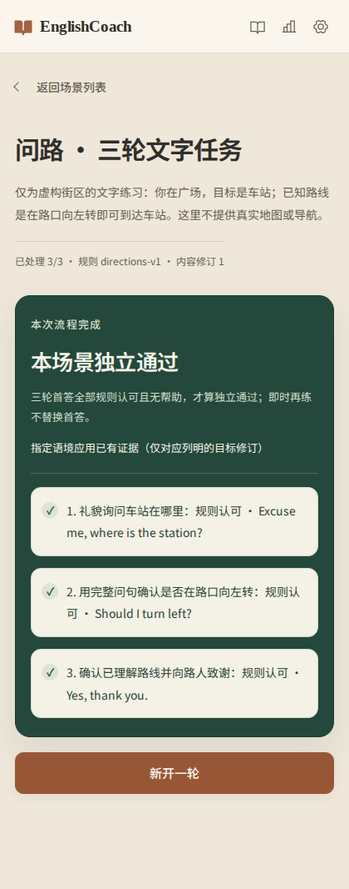

# EL-15 场景页视觉调整（2026-11-03）

用户指出完成页过白、排版和视觉不足，并明确确认“暖砂背景＋深松绿结果区＋陶土色点缀”，同步列表、作答与完成状态，保留现有功能。此前用户也已人工核对并接受 introduction.json 和 directions.json 的英语表达与任务边界。

## 范围与固定点

- 固定审查范围：`58301333bfc25d12d643ca900b14bc6bf4f99377...5c6d8ff899007eb8418d75e0f07039f2cfc2a165`。
- 只改 ScenePage 的展示 class/data 属性、新增场景 CSS、在 main 最后引入样式。桌面将情境与结果分栏，窄屏堆叠；三轮回答分行；列表、作答、帮助、反馈沿用同一配色。
- Babel AST 对比忽略这些展示属性与 CSS import 后，ScenePage.jsx、main.jsx 与固定点完全一致：处理器、条件、数据访问、提交身份与状态流程不变。
- 原 EL-15 业务与边界验收见 [主报告](el15-intro-and-directions-scenes.md)。这次没有改 API、权限、数据范围、幂等、审计、错误码、并发、数据库或场景材料。

## 验证

命令来自 frontend/package.json、现有 E2E runner 和 docs/agents/development.md。最终源码冻结后执行：

```bash
.venv/bin/python scripts/agent_check.py --base dev
EC_CHROMIUM_EXECUTABLE=/home/clusteradmin/.cache/ms-playwright/chromium_headless_shell-1248/chrome-headless-shell-linux-arm64/chrome-headless-shell npm --prefix frontend run test:e2e -- --ticket EL-15
EC_CHROMIUM_EXECUTABLE=/home/clusteradmin/.cache/ms-playwright/chromium_headless_shell-1248/chrome-headless-shell-linux-arm64/chrome-headless-shell npm --prefix frontend run test:e2e -- --ticket EL-14
git diff --check
```

- 基线检查通过：origin/dev=`4413c950fe8ddf02c69d3c3a304ca2956f96594a`。
- 最终 EL-15：38 passed；EL-14：26 passed。无跳过或重试，两个 runner 均重新构建并使用独立端口、真实迁移的隔离 SQLite，最终退出码均为 0。
- 两个最终报告的源码 SHA-256 均为 `89305fcc46f4c8fd11ce3ec8dcf13800d79526de14ca4865d86dd8d38bf21340`；提交产品后重新计算仍一致。本报告和截图随后单独提交。
- 最终诊断：`e2e/release-results/ec-e2e-static-jHo805`（EL-15）、`ec-e2e-static-lrNkPw`（EL-14），run.json 均为 passed；诊断目录由仓库忽略。
- 已读取实际构建截图：桌面 1280px、手机 420px。另在隔离预览中检查列表、作答、结果和暗色标准表达；820px 平板无横向溢出。
- 键盘 Tab 从朗读按钮进入答案框，焦点显示 solid 2px 边框。暗色标准面板背景最终为 rgb(45,52,45)，朗读按钮文字为 rgb(182,176,163)。

## 红灯、修复与双轴审查

视觉调整使用已有行为测试和实际截图检查，没有新增绑定 CSS 实现的测试。早期运行的精确按钮定位失败揭示装饰箭头改变了无障碍名称；改为空内容边框图形，原测试恢复通过。判定装饰符号也提供空替代文本，保留完整判定文字。

独立 Standards／Spec 审查发现并修复辅助文字、反馈按钮、暗色悬停与标准表达面板的对比度问题；最后一项在真实暗色预览中先复现再修复、截图确认。最终实测标准表达文字对比度为浅色 9.65:1／暗色 10.54:1，朗读按钮为 5.83:1／5.93:1。失败或中断的候选运行不作为最终通过证据。

Standards：固定提交差异复审无待处理问题。Spec：固定提交差异符合用户确认的视觉方向，无待处理问题。审查仅覆盖本次视觉增量，未运行全仓门禁。

## N/A、未验证与回退

- 独立前端 lint/type 脚本未配置，N/A；Python 未修改，本次未重跑后端单测/Pyright，原业务证据保留在主报告。
- 数据迁移、发布/恢复路径与新增 ADR：N/A，没有数据或架构决策变化。备份恢复、错误与幂等分支仍由本次 EL-14/15 浏览器回归覆盖。
- 全仓测试、完整发布门禁、跨浏览器/跨平台及真实部署：未验证，本报告仅证明上述局部范围。
- 无新增依赖、外部资源、密钥或生产数据。临时预览和测试数据不提交。
- 可回退产品提交 `5c6d8ff`；也可移除 main.jsx 的 scene-page.css import 恢复原样式，学习记录不受影响。

## 最终截图




